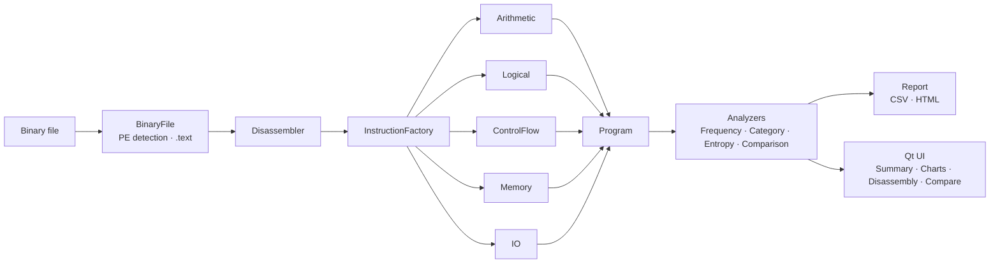

<div align="center">

# 🛡️ Binary Opcode Analyzer

**A Qt desktop tool that looks inside compiled binaries: x86 opcode distribution, Shannon entropy,
disassembly and side-by-side comparison**


[Features](#-features) · [How it works](#-how-it-works) · [Build](#-build) · [Report](OpcodeAnalyzer_IEEE_Report.pdf) · [Türkçe](#-türkçe)

</div>

---

Open an `.exe`, `.dll`, `.sys`, `.bin` or any raw file, and the analyzer shows what kind of code is
inside: how much of it moves data, does arithmetic or branches, whether a region looks **packed or
encrypted**, and how two binaries differ. The project was built for an Object-Oriented Programming course
and is written up in an [IEEE-style report](OpcodeAnalyzer_IEEE_Report.pdf).

## ✨ Features

- **PE-aware loading**: detects Windows PE files and focuses the analysis on the `.text` code section. Any other file is analysed as a raw byte stream.
- **x86 opcode table**: maps single-byte opcodes into **9 categories**: data transfer, arithmetic, logic, control flow, string, bit-shift, system, FPU and prefixes.
- **Entropy analysis**: Shannon entropy highlights packed or encrypted segments.
- **Disassembly view**: per-byte table with colour-coded categories.
- **Interactive charts**: pie and bar charts of the category distribution (Qt Charts).
- **Compare mode**: put two binaries side by side and diff their instruction profiles.
- **Reports**: export results as **CSV** or **HTML**.
- **Dark and light themes**: custom QSS with high-contrast cyan accents, plus a recent-files list.
- **`opcgen` tool**: generates sample `.opc` programs (`hello`, `loop`, `packed`) for testing low- and high-entropy cases.

## 🧩 How it works



The core follows classic OOP. An abstract `Instruction` hierarchy is created through a
**factory**, and pluggable `Analyzer` strategies run over a `Program`.

## 🚀 Build

Requirements: CMake 3.20+, Qt 6 (Widgets and Charts), and MSVC 2022, GCC or Clang.

```bash
git clone https://github.com/Soap2647/Binary-Opcode-Analyzer.git
cd Binary-Opcode-Analyzer
cmake -B build -DCMAKE_PREFIX_PATH=/path/to/Qt/6.x/<kit>
cmake --build build --config Release
```

On Windows, the build runs `windeployqt6` automatically so the executable can be started directly.

## 📁 Project structure

```
src/
├── core/       BinaryFile, Disassembler, OpcodeTable, Instruction hierarchy, Program
├── analysis/   Frequency, Category, Entropy and Comparison analyzers, Report
├── ui/         MainWindow, SummaryView, ChartView, DisassemblyView, CompareView, ThemeManager
├── tools/      opcgen (sample generator)
└── main.cpp
resources/      QSS themes
samples/        hello.opc, loop.opc, packed.opc
```

## 🇹🇷 Türkçe

**Binary Opcode Analiz Aracı**, derlenmiş dosyaların içindeki x86 talimatlarını inceleyen bir Qt masaüstü
uygulamasıdır. PE dosyalarında `.text` bölümünü bulur, opcode'ları 9 kategoriye ayırır, Shannon entropisi ile
paketlenmiş/şifrelenmiş bölgeleri işaret eder, iki dosyayı yan yana karşılaştırır ve sonuçları CSV/HTML olarak
dışa aktarır. Nesneye Yönelik Programlama dersi kapsamında geliştirilmiştir. Ayrıntılar IEEE formatındaki raporda yer alır.

---

<div align="center"><sub>MIT License · Built by <a href="https://github.com/Soap2647">Mert Yasin Yılmaz</a></sub></div>
